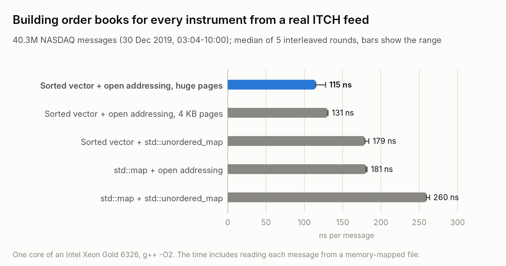
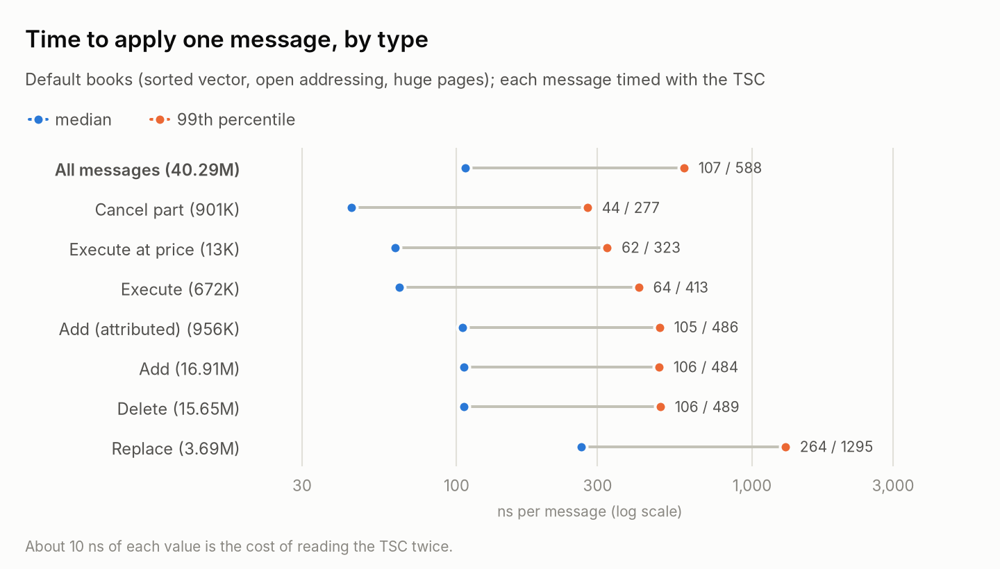
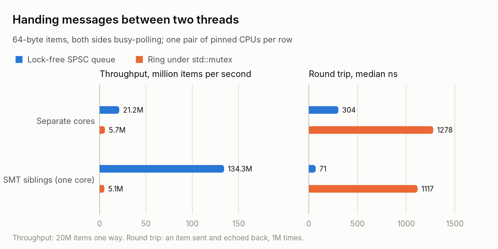
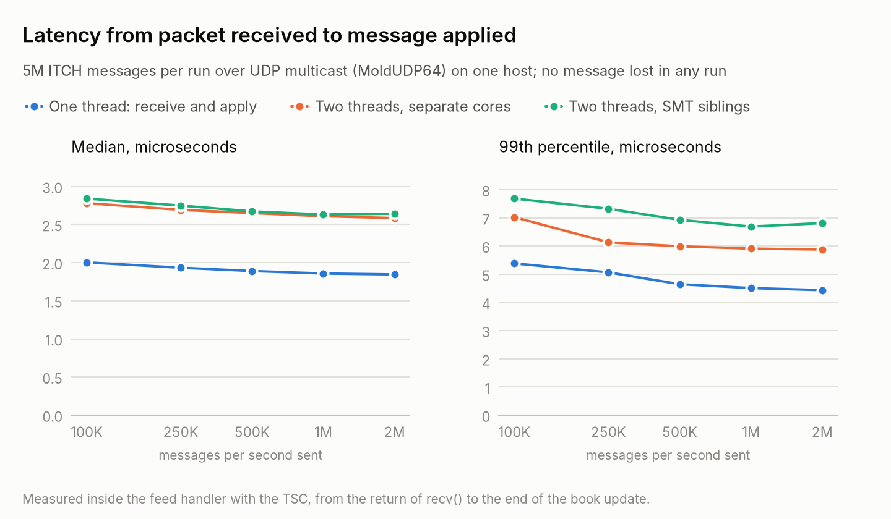

# itch-orderbook

A NASDAQ TotalView-ITCH 5.0 feed handler and limit order book in C++20. It receives the feed over UDP multicast
in MoldUDP64 packets, detects lost packets from their sequence numbers, and keeps full-depth order books for
every instrument, optionally handing messages from the network thread to a book thread through a lock-free
queue. A matching engine with price-time priority runs on the same books. Everything is measured on real
NASDAQ data: 40.3 million messages from 30 December 2019, 03:04 to 10:00, covering the pre-market and the
first half hour of trading.

<p align="center">
<picture>
  <source media="(prefers-color-scheme: dark)" srcset="docs/figures/architecture-dark.png">
  
</picture>
</p>

## Results at a glance

On a server with an Intel Xeon Gold 6326, one core per thread, g++ 11 with `-O2`:

| Measure | Result |
|---|---|
| Building books for every instrument from 40.3M real messages | **115 ns per message**; with `std::map` levels and `std::unordered_map` for orders: 260 ns |
| One message, median / 99th percentile | 107 / 588 ns |
| Thread hand-off, lock-free SPSC queue against a ring under `std::mutex` | 21.2M against 5.7M items/s; round trip 304 against 1,278 ns |
| Multicast feed to books, 5M messages at up to 2M messages/s | no message lost; packet received to message applied: median 1.85-2.0 us, 99th percentile 4.4-5.4 us |
| Correctness on the real feed | 0 unknown orders and 0 over-executions in 40.3M messages; an independent Python replay agrees on all 8,890 instruments with orders |
| Gap detection | 1,096 packets dropped on purpose: exactly the 50,080 messages in them counted as missed |

## How it works

### Decoding the feed

[`src/itch.h`](src/itch.h) decodes the ITCH 5.0 messages that change the visible book: add (A, F), execute
(E, C), cancel part of an order (X), delete (D), replace (U), and the stock directory (R) that names each
instrument. Fields are big-endian, read with `memcpy` and a byte swap; prices carry four implied decimals.
[`src/itch_file.h`](src/itch_file.h) memory-maps one of NASDAQ's sample files. Their layout is not documented:
each message turns out to be preceded by its 2-byte big-endian length, as in a MoldUDP64 message block.

### Order books

[`src/order_book.h`](src/order_book.h), [`src/feed_book.h`](src/feed_book.h).

- **One book per instrument**, indexed directly by ITCH stock locate (65,536 books, never resized).
- **Orders in a pool**: one vector of 32-byte orders, with freed slots reused. A level keeps its orders in
  time priority (FIFO) as a doubly linked list of pool indices, so adding, removing and shrinking an order
  needs no allocation.
- **Order index**: order reference number to pool slot, by open addressing with linear probing (16-byte
  slots, Fibonacci hashing, at most half full). An erase shifts the rest of its probe run back instead of
  leaving a tombstone; the feed deletes nearly every order it adds.
- **Price levels**, two interchangeable containers: a `std::map` per side (best first), or a vector sorted
  from worst to best, searched from the back, since most changes happen near the top of the book.
- **Huge pages**: the pool and the index come from `mmap` and are marked `MADV_HUGEPAGE`, which cuts the TLB
  misses of random reads across more than 100 MB.

### Matching engine

[`src/matching_engine.h`](src/matching_engine.h) uses the same books the way an exchange does. An incoming
order trades against the other side in price-time priority (best price first, then oldest), at the resting
order's price. What is left of a day order rests on the book; an immediate-or-cancel order drops it.

### From the network to the books

- [`src/moldudp64.h`](src/moldudp64.h): MoldUDP64, NASDAQ's framing for ITCH over UDP. A 20-byte header (session,
  sequence number of the first message, message count), then length-prefixed messages. A sequence tracker
  counts lost messages and skips duplicates.
- [`src/udp.h`](src/udp.h): multicast sockets on one interface (loopback here). The sender sets TTL 0, so
  nothing leaves the host. The receiver does not block, so it can busy-poll.
- [`src/spsc_queue.h`](src/spsc_queue.h): a lock-free queue for one producer and one consumer thread. A slot is
  published with a release store and read after an acquire load; each side's index sits on its own cache
  line with a private copy of the other's, so the threads share a line only when the queue looks full or
  empty.
- [`tools/publisher.cpp`](tools/publisher.cpp) replays a file as one MoldUDP64 session at a set message rate,
  and can drop every Nth packet on purpose. [`tools/feed_handler.cpp`](tools/feed_handler.cpp) receives it,
  either updating the books in the receive thread or handing each message to a book thread through the
  queue, and measures the latency from `recv()` returning a packet to each of its messages being applied.

## Benchmarks

`scripts/run_all.sh <machine>` runs everything below and writes `results/<machine>/`; `scripts/plots.py
<machine>` draws the figures, which show the server. The book timings are medians of five rounds; the queue and
pipeline numbers come from one run each.

### Building books

<p align="center">
<picture>
  <source media="(prefers-color-scheme: dark)" srcset="docs/figures/book-dark.png">
  
</picture>
</p>

[`bench/bench_book.cpp`](bench/bench_book.cpp) replays the whole file into fresh books with each design, five
rounds with the designs in rotating order, after one pass that maps the file's pages. The first round ran
slower on both machines (127 and 200 ns for the default design); the median absorbs it.

- **Sorted vector against `std::map`:** changes cluster near the top of the book, so a scan of contiguous
  levels from the best price beats a walk down a tree of separately allocated nodes.
- **Open addressing against `std::unordered_map`:** a lookup reads the slot it needs, usually one cache line,
  instead of reading a bucket and following a pointer to a node.
- **Huge pages:** 12% on the server, 6% on the laptop. The order index (128 MB) and the pool span well over
  100 MB, and with 4 KB pages most random reads there also miss the TLB.

<p align="center">
<picture>
  <source media="(prefers-color-scheme: dark)" srcset="docs/figures/message-latency-dark.png">
  
</picture>
</p>

A replace costs the most: it removes one order and adds another, often at a different price level.

### Handing messages between threads

<p align="center">
<picture>
  <source media="(prefers-color-scheme: dark)" srcset="docs/figures/queue-dark.png">
  
</picture>
</p>

[`bench/bench_queue.cpp`](bench/bench_queue.cpp) runs both queues between two pinned threads. The mutex
version loses to lock traffic and, under contention, to futex system calls. Two SMT threads of one core share
their L1 and L2 caches, so on the server a hand-off there costs a quarter of one between cores.

### Feed handler

<p align="center">
<picture>
  <source media="(prefers-color-scheme: dark)" srcset="docs/figures/pipeline-dark.png">
  
</picture>
</p>

[`scripts/run_pipeline.sh`](scripts/run_pipeline.sh) runs the publisher and the feed handler on one host,
5M messages per run (the first 5M of the file, all before the 09:30 open), at 100K to 2M messages per second.

- **No message was lost** at any rate in any set-up.
- **One thread was faster than two at every rate**, by about 0.75 us at the median. Each hand-off moves a
  message's cache line to another core, and the 40-odd messages of a packet are applied one after another, so
  those transfers add up; at about 0.1 us of book work per message, a second thread does not pay for itself.
  The book thread on the receive thread's SMT sibling did not help on the server.
- **What the latency covers:** from the moment `recv()` returns a packet to the end of each message's book
  update. It leaves out the kernel's network stack, which a production feed handler bypasses with a
  kernel-bypass network card, and the network here is loopback on one host.

### The same benchmarks on a laptop

| Measure | Laptop: Intel Core i5-1035G1, g++ 13 | Server: Intel Xeon Gold 6326, g++ 11 |
|---|---|---|
| Books: sorted vector + open addressing, huge pages | 146 ns per message | 115 |
| the same on 4 KB pages | 156 | 131 |
| sorted vector + `std::unordered_map` | 235 | 179 |
| `std::map` + open addressing | 284 | 181 |
| `std::map` + `std::unordered_map` | 380 | 260 |
| One message, median / 99th percentile | 118 / 747 ns | 107 / 588 |
| SPSC queue, separate cores: items/s, round trip | 27.7M, 121 ns | 21.2M, 304 ns |
| Ring under `std::mutex`, separate cores | 3.1M, 1,406 ns | 5.7M, 1,278 ns |
| SPSC queue, SMT siblings | 128.9M, 71 ns | 134.3M, 71 ns |
| Feed handler, one thread: median / 99th percentile | 2.2-3.6 / 7.1-16.9 us | 1.85-2.0 / 4.4-5.4 us |

The laptop's cores are closer together (a hand-off between them is faster), but its clock speed changes under
load, so its results vary more from run to run.

## Correctness

`make test` runs seven test programs; `make sanitize` runs them again under AddressSanitizer and
UndefinedBehaviorSanitizer, and the queue test under ThreadSanitizer.

- **Order books:** fixed cases, and random valid feeds on three instruments compared with a reference (a map
  of orders, levels by sorting) after every 20 messages: every level of both sides and the order of every
  queue, 60,000 comparisons, for both level containers.
- **The real feed:** 0 unknown orders and 0 over-executions in 40.3M messages. [`scripts/check_books.py`](scripts/check_books.py),
  a separate Python implementation with a plain dict of orders, replays the same file and agrees with the C++
  books on all 8,890 instruments with orders: levels, best bid and ask, shares and orders per side.
- **Matching engine:** 100,000 random orders and cancels against a reference that searches for the best order
  at every fill: every trade, in order, and both sides of the book.
- **Order index:** random operations against `std::unordered_map`, including a half-full 16-slot table where
  probe runs wrap around the end.
- **SPSC queue:** 10M items through two threads, in order and intact. ThreadSanitizer is clean, and reports a
  data race when the store that publishes a slot is weakened from release to relaxed.
- **Network pieces:** MoldUDP64 framing; sequence tracking, including a loss just before the end of a session
  and a packet cut short; loopback multicast; the latency histogram and the TSC clock.

Each test was also run against deliberately broken versions of the code it covers (wrong deletion rules,
newest-first queues, trades at the wrong price, an immediate-or-cancel order left on the book); all of them
fail.

## Build and run

Needs Linux, g++ 11 or newer (or clang), and make; the data download needs curl, the check script and figures
Python 3 (figures: matplotlib).

```sh
make                 # builds into build/
make test
make sanitize
scripts/fetch_itch.sh    # the first 500 MB of NASDAQ's 30 Dec 2019 sample: 1.26 GB decompressed
./build/replay data/itch/12302019.NASDAQ_ITCH50.first500MB --symbol AAPL --depth 3
```

```text
40287943 messages in 5.50 s: 136.6 ns per message (levels vector, index flat)
adds 17863760, executions 684933, cancels 901427, deletes 15651635, replaces 3693371, other 1492817
unknown orders 0, over-executed 0, orders on the book at the end 1708375
AAPL (locate 13): 3603 bid levels, 1070 ask levels
  bids:  300 @ 287.0000 (1)  200 @ 286.9900 (2)  105 @ 286.9800 (2)
  asks:  400 @ 287.0400 (3)  300 @ 287.0500 (3)  200 @ 287.0600 (2)
```

That run is on the laptop (`taskset -c 2`). AAPL's book at 10:00:39: best bid $287.00, best ask $287.04.

The feed over multicast, on one host (the sender's TTL is 0, so nothing leaves the machine):

```sh
./build/feed_handler --threads 1 --rx-cpu 2 &
./build/publisher data/itch/12302019.NASDAQ_ITCH50.first500MB --rate 1000000 --limit 5000000 --cpu 1
```

All benchmarks: `scripts/run_all.sh <machine>`. Its CPU numbers suit a 4-core laptop; see the script for the
variables to set on other machines.

## Layout

```text
src/itch.h, itch_file.{h,cpp}   ITCH 5.0 decoding; memory-mapped feed files
src/order_book.h                one instrument's book: price levels, FIFO queues, the order pool
src/order_index.{h,cpp}         order reference -> pool slot: open addressing, backward-shift deletion
src/feed_book.{h,cpp}           books for every instrument, driven by ITCH messages
src/matching_engine.h           price-time-priority matching on the same books
src/huge_pages.h                allocator on 2 MB transparent huge pages
src/spsc_queue.h                lock-free single-producer, single-consumer queue
src/moldudp64.h, udp.{h,cpp}    MoldUDP64 framing and sequence tracking; multicast sockets
src/latency.h, cpu.h            TSC clock and latency histogram; thread pinning
tools/                          itch_stats, replay, publisher, feed_handler
tests/                          unit, differential and random tests
bench/                          book and queue benchmarks
scripts/                        data download, Python check, benchmark runs, figures
results/<machine>/              the benchmark output behind this README
```

## Data and references

- NASDAQ TotalView-ITCH 5.0 and MoldUDP64 specifications (NASDAQ).
- Sample data: NASDAQ's public ITCH files, <https://emi.nasdaq.com/ITCH/Nasdaq%20ITCH/>. They are downloaded by
  [`scripts/fetch_itch.sh`](scripts/fetch_itch.sh) and are not included in this repository.
